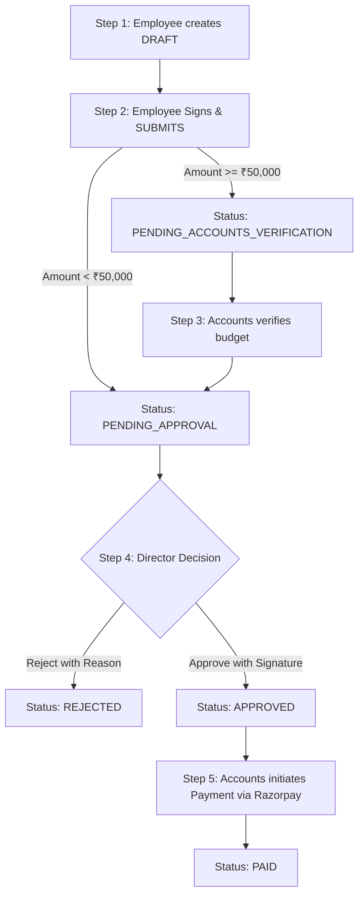

# 📘 Expense Voucher Approval System - સંપૂર્ણ પ્રોજેક્ટ માર્ગદર્શિકા (Complete Project Guide)

આ દસ્તાવેજમાં આખા પ્રોજેક્ટનું આર્કિટેક્ચર, ડેટાબેઝ, સ્ટેપ-બાય-સ્ટેપ વર્કફ્લો, યુઝર રોલ્સ અને પ્રોજેક્ટ રન કરવાની વિગતો સરળ ભાષામાં સમજાવવામાં આવી છે.

---

## 📑 અનુક્રમણિકા (Table of Contents)
1. [પ્રોજેક્ટનો પરિચય (Project Overview)](#1-પ્રોજેક્ટનો-પરિચય-project-overview)
2. [ટેકનોલોજી સ્ટેક (Tech Stack)](#2-ટેકનોલોજી-સ્ટેક-tech-stack)
3. [ડેટાબેઝ અને ફાઇલ સ્ટોરેજ (Database & Storage Architecture)](#3-ડેટાબેઝ-અને-ફાઇલ-સ્ટોરેજ-database--storage-architecture)
4. [યુઝર રોલ્સ અને અધિકારો (User Roles & Permissions)](#4-યુઝર-રોલ્સ-અને-અધિકારો-user-roles--permissions)
5. [સ્ટેપ-બાય-સ્ટેપ વાઉચર લાઈફસાયકલ (Step-by-Step Voucher Lifecycle)](#5-સ્ટેપ-બાય-સ્ટેપ-વાઉચર-લાઈફસાયકલ-step-by-step-voucher-lifecycle)
6. [પ્રોજેક્ટ ફોલ્ડર સ્ટ્રક્ચર (Project Directory Structure)](#6-પ્રોજેક્ટ-ફોલ્ડર-સ્ટ્રક્ચર-project-directory-structure)
7. [API એન્ડપોઇન્ટ્સ (Key API Endpoints)](#7-api-એન્ડપોઇન્ટ્સ-key-api-endpoints)
8. [પ્રોજેક્ટ કેવી રીતે રન કરવો (How to Run the Project)](#8-પ્રોજેક્ટ-કેવી-રીતે-રન-કરવો-how-to-run-the-project)
9. [ડેમો ક્રેડેન્શિયલ્સ (Demo Login Accounts)](#9-ડેમો-ક્રેડેન્શિયલ્સ-demo-login-accounts)

---

## 1. પ્રોજેક્ટનો પરિચય (Project Overview)

આ સિસ્ટમ કંપનીમાં થતા ખર્ચાઓ (Expenses) માટે વાઉચર બનાવવા, તેને ડિરેક્ટર દ્વારા મંજૂર (Approve) કરવા અને એકાઉન્ટ્સ વિભાગ દ્વારા પેમેન્ટ કરવાની એક **Secure & Automated Workflow Web Application** છે.

### મુખ્ય સુવિધાઓ (Key Highlights):
* **રોલ-બેઝ્ડ એક્સેસ કંટ્રોલ (RBAC)**: Employee, Director અને Accounts માટે અલગ-અલગ ડેશબોર્ડ અને પાવર્સ.
* **ડિજિટલ સિગ્નેચર (Signature Pad)**: સબમિટ અને અપ્રુવ વખતે કર્મચારી તથા ડિરેક્ટર પોતાની ડિજિટલ સહી ડ્રો અથવા અપલોડ કરી શકે છે.
* **ડાયનેમિક અપ્રુવલ રૂલ**: 
  * ₹50,000 થી ઓછી રકમ: સીધી ડિરેક્ટર મંજૂરી માટે જાય છે (`PENDING_APPROVAL`).
  * ₹50,000 કે તેથી વધુ રકમ: પહેલાં એકાઉન્ટ્સ વેરિફિકેશન માટે જાય છે (`PENDING_ACCOUNTS_VERIFICATION`), ત્યારબાદ ડિરેક્ટર પાસે જાય છે.
* **પેમેન્ટ ગેટવે ઇન્ટિગ્રેશન**: એકાઉન્ટ્સ ટીમ Razorpay દ્વારા સીધું વાઉચર પેમેન્ટ ક્લિયર કરી શકે છે.
* **ડાર્ક મોડ ગ્લાસ ગ્રાફિક્સ અને પેરાલેક્સ ઇફેક્ટ**: આકર્ષક કસ્ટમ વિન્ટેજ ટિકિટ વોટરમાર્ક બેકગ્રાઉન્ડ સાથે રિસ્પોન્સિવ મોડર્ન UI.
* **ઇમેઇલ અને ઇન-એપ નોટિફિકેશન્સ**: વાઉચર સબમિટ, અપ્રુવ કે રિજેક્ટ થતાં રિયલ-ટાઇમ નોટિફિકેશન અને ઇમેઇલ એલર્ટ્સ.

---

## 2. ટેકનોલોજી સ્ટેક (Tech Stack)

### Frontend (ક્લાયન્ટ)
* **Framework**: React 18 + TypeScript + Vite
* **Styling**: Tailwind CSS + Custom CSS (Glassmorphism & Dark Obsidian Palette)
* **Icons & Animation**: Lucide React + Framer Motion
* **Charts**: Recharts (Donut Charts with detailed legends & breakdown)
* **State & Data Fetching**: TanStack React Query + Axios

### Backend (સર્વર)
* **Runtime & Framework**: Node.js + Express.js + TypeScript
* **Database ORM**: Prisma ORM
* **Database**: SQLite (`dev.db`)
* **Security & Auth**: JWT (JSON Web Tokens) + Bcrypt Password Hashing + Magic Bytes File Inspection
* **Payment**: Razorpay Node SDK
* **Email**: Nodemailer (Ethereal test mail / SMTP)

---

## 3. ડેટાબેઝ અને ફાઇલ સ્ટોરેજ (Database & Storage Architecture)

### ૧. SQLite Database ફાઇલ
* **લોકેશન**: `server/prisma/dev.db`
* આ એક સિંગલ ફાઇલ ડેટાબેઝ છે જે પ્રિઝ્મા ઓઆરએમ સાથે કનેક્ટેડ છે (`file:./dev.db`).
* **મુખ્ય ટેબલ્સ (Tables)**:
  * `User`: વપરાશકર્તાની વિગતો (નામ, ઈમેલ, રોલ, ડિપાર્ટમેન્ટ, એમ્પ્લોયી કોડ, સહીની લિંક).
  * `Voucher`: વાઉચર નંબર (`VCH-YYYY-NNNN`), રકમ, ટાઈટલ, કેટેગરી, તારીખ, સ્ટેટસ, સહીઓ અને ટ્રાન્ઝેક્શન આઈડી.
  * `VoucherActivity`: ઑડિટ લોગ (કોણે, ક્યારે અને કઈ ક્રિયા કરી).
  * `Notification`: વપરાશકર્તાઓ માટેના ઇન-એપ મેસેજીસ.

### ૨. ફાઇલ સ્ટોરેજ (Uploads)
* **સહીઓ (Signatures)**: `server/uploads/signatures/`
* **રસીદો/બિલ્સ (Receipts)**: `server/uploads/receipts/`
* *નોંધ*: ફાઇલો ડિરેક્ટરીમાં સેવ થાય છે અને તેનો એક્સેસિબલ URL પાથ ડેટાબેઝમાં સાચવવામાં આવે છે.

---

## 4. યુઝર રોલ્સ અને અધિકારો (User Roles & Permissions)

| રોલ (Role) | કરી શકે છે (Allowed Actions) | મનાઈ છે (Restricted Actions) |
|---|---|---|
| **EMPLOYEE** | • નવું વાઉચર બનાવવું (Create Draft)<br>• ડ્રાફ્ટ એડિટ/ડિલીટ કરવું<br>• સહી જોડીને વાઉચર સબમિટ કરવું<br>• પોતાના વાઉચર્સનું લિસ્ટ/સ્ટેટસ જોવું<br>• પ્રોફાઇલ & ડિજિટલ સહી અપડેટ કરવી | • અન્ય કોઈના વાઉચર જોવા/એડિટ કરવા<br>• સબમિટ કર્યા પછી વાઉચર બદલવું<br>• વાઉચર અપ્રુવ કે પે કરવું |
| **DIRECTOR** | • બધા સબમિટ થયેલા વાઉચર્સ જોવા<br>• સહી જોડીને વાઉચર **Approve** કરવું<br>• કારણ આપીને વાઉચર **Reject** કરવું<br>• કંપની-વાઇડ ડેશબોર્ડ એનાલિટિક્સ જોવું | • નવું વાઉચર બનાવવું<br>• ડ્રાફ્ટ વાઉચર એડિટ કરવું<br>• પેમેન્ટ ટ્રાન્ઝેક્શન કરવું |
| **ACCOUNTS** | • બધા વાઉચર્સ મોનિટર કરવા<br>• ₹50,000+ ના વાઉચર્સ **Verify (Budget Check)** કરવા<br>• Approved વાઉચર્સ માટે **Razorpay Payment** કરવું<br>• ફાઇનાન્સિયલ ડેશબોર્ડ એનાલિટિક્સ જોવું | • નવું વાઉચર બનાવવું<br>• વાઉચર Approve કરવું |

---

## 5. સ્ટેપ-બાય-સ્ટેપ વાઉચર લાઈફસાયકલ (Step-by-Step Voucher Lifecycle)



### સ્ટેપ ૧: વાઉચર ક્રિએશન (Employee Draft)
1. કર્મચારી લોગિન કરી **"Create Voucher"** બટન પર ક્લિક કરે છે.
2. ટાઈટલ, કેટેગરી (Travel, Food, Supplies વગેરે), રકમ, તારીખ, ડિપાર્ટમેન્ટ અને રસીદનો ફોટો (જો હોય તો) ભરે છે.
3. વાઉચર **DRAFT** સ્ટેટસમાં સેવ થાય છે. જ્યાં સુધી સબમિટ ન થાય ત્યાં સુધી કર્મચારી તેમાં ગમે ત્યારે ફેરફાર અથવા ડિલીટ કરી શકે છે.

### સ્ટેપ ૨: ડિજિટલ સહી અને સબમિશન (Submit Voucher)
1. વાઉચરની વિગત પેજ પર જઈ **"Submit"** પર ક્લિક કરે છે.
2. સ્ક્રીન પર **સેન્ટર્ડ મોડલ પોપઅપ** ખુલે છે.
3. કર્મચારી પોતાની સહી **Upload** કરે છે અથવા **Draw** (કેનવાસ પર પેન વડે) કરે છે.
4. સબમિટ થતાં જ વાઉચર લોક થઈ જાય છે (હવે તેમાં એડિટિંગ અશક્ય છે).
5. જો રકમ ₹50,000 થી ઓછી હોય તો સ્ટેટસ `PENDING_APPROVAL` બને છે, અન્યથા `PENDING_ACCOUNTS_VERIFICATION` બને છે.

### સ્ટેપ ૩: બજેટ વેરિફિકેશન (Accounts Verification - મોટા ખર્ચા માટે)
1. ₹50,000 કે તેથી વધુ રકમના વાઉચર પર એકાઉન્ટ્સ ટીમ **"Verify (Budget Check)"** કરે છે.
2. વેરિફિકેશન સફળ થતાં સ્ટેટસ `PENDING_APPROVAL` બની ડિરેક્ટર પાસે પહોંચે છે.

### સ્ટેપ ૪: ડિરેક્ટર મંજૂરી (Director Approval / Rejection)
1. ડિરેક્ટર લોગિન કરી પેન્ડિંગ વાઉચર તપાસે છે.
2. **Approve**: ડિરેક્ટર પોતાની ડિજિટલ સહી ઉમેરીને મંજૂર કરે છે -> સ્ટેટસ `APPROVED` બને છે.
3. **Reject**: ડિરેક્ટર અસ્વીકારનું કારણ (Reason) દાખલ કરે છે -> સ્ટેટસ `REJECTED` બને છે.
4. કર્મચારીને ઇમેઇલ અને ઇન-એપ નોટિફિકેશન તરત પહોંચે છે.

### સ્ટેપ ૫: પેમેન્ટ પ્રોસેસિંગ (Accounts Payment Execution)
1. એકાઉન્ટ્સ ટીમ `APPROVED` વાઉચર પર **"Pay via Razorpay"** પર ક્લિક કરે છે.
2. Razorpay પેમેન્ટ વિન્ડો ખુલે છે અને પેમેન્ટ પૂર્ણ થાય છે.
3. ટ્રાન્ઝેક્શન આઈડી સેવ થાય છે અને વાઉચર `PAID` સ્ટેટસમાં ફેરવાય છે.
4. કર્મચારીને પેમેન્ટ પૂર્ણ થયાની રસીદ અને પુષ્ટિ મેઈલ મળે છે.

---

## 6. પ્રોજેક્ટ ફોલ્ડર સ્ટ્રક્ચર (Project Directory Structure)

```text
assignment protliz/
├── client/                          # React Frontend
│   ├── src/
│   │   ├── app/
│   │   │   ├── providers/           # AuthProvider & Axios Interceptors
│   │   │   └── routes/              # Protected Routes
│   │   ├── components/
│   │   │   ├── layout/              # Topbar, ParallaxBackground, SplashScreen
│   │   │   └── ui/                  # Button, Modal, Card, Toast, SignaturePad
│   │   ├── features/
│   │   │   ├── auth/                # Login Page
│   │   │   ├── dashboard/           # Role-based Analytics & Donut Charts
│   │   │   ├── vouchers/            # VoucherList, VoucherForm, VoucherDetails
│   │   │   └── profile/             # ProfileModal (Details & Signature)
│   │   └── index.css                # Obsidian Dark Theme & Global Styles
│   └── package.json
│
├── server/                          # Node.js Express Backend
│   ├── prisma/
│   │   ├── schema.prisma            # Database Schema definition
│   │   ├── seed.ts                  # Initial dummy users & vouchers seed
│   │   └── dev.db                   # SQLite Database File
│   ├── src/
│   │   ├── controllers/             # auth.ts, vouchers.ts, users.ts, notifications.ts
│   │   ├── middleware/              # auth.ts (JWT), upload.ts (Multer), errorHandler.ts
│   │   ├── services/                # voucher.service.ts (Business logic & audit logs)
│   │   ├── utils/                   # email.ts, token.ts
│   │   └── server.ts                # Express app bootstrap
│   ├── uploads/                     # File attachments (Signatures & Receipts)
│   └── package.json
└── PROJECT_GUIDE.md                 # આ માર્ગદર્શિકા ફાઇલ
```

---

## 7. API એન્ડપોઇન્ટ્સ (Key API Endpoints)

| પદ્ધતિ (Method) | એન્ડપોઇન્ટ (Endpoint) | ઉપયોગ (Purpose) | અધિકાર (Access) |
|---|---|---|---|
| `POST` | `/api/auth/login` | યુઝર લોગિન અને JWT ટોકન મેળવવું | Public |
| `GET` | `/api/auth/me` | હાલના લૉગિન યુઝરની વિગતો મેળવવી | Any Auth |
| `PUT` | `/api/users/profile` | પ્રોફાઇલ વિગતો અપડેટ કરવી | Any Auth |
| `POST` | `/api/users/signature` | પ્રોફાઇલ સહી અપલોડ કરવી | Any Auth |
| `GET` | `/api/vouchers` | વાઉચર્સની યાદી (ફિલ્ટર અને સર્ચ સાથે) | Role scoped |
| `POST` | `/api/vouchers` | નવું વાઉચર બનાવવું (Draft) | Employee |
| `PUT` | `/api/vouchers/:id` | ડ્રાફ્ટ વાઉચર એડિટ કરવું | Employee |
| `DELETE` | `/api/vouchers/:id` | ડ્રાફ્ટ વાઉચર ડિલીટ કરવું | Employee |
| `POST` | `/api/vouchers/:id/submit` | સહી સાથે વાઉચર સબમિટ કરવું | Employee |
| `POST` | `/api/vouchers/:id/approve` | સહી સાથે વાઉચર મંજૂર કરવું | Director |
| `POST` | `/api/vouchers/:id/reject` | કારણ આપી વાઉચર અસ્વીકાર કરવું | Director |
| `POST` | `/api/vouchers/:id/verify` | બજેટ વેરિફિકેશન કરવું (₹50k+) | Accounts |
| `POST` | `/api/vouchers/:id/pay` | Razorpay પેમેન્ટ ઓર્ડર જનરેટ કરવો | Accounts |
| `POST` | `/api/vouchers/:id/verify-payment` | પેમેન્ટ કન્ફર્મ કરી PAID કરવું | Accounts |
| `GET` | `/api/dashboard/stats` | ભૂમિકા મુજબ ડેશબોર્ડ આંકડા મેળવવા | Role scoped |

---

## 8. પ્રોજેક્ટ કેવી રીતે રન કરવો (How to Run the Project)

### ૧. બેકએન્ડ સર્વર ચલાવવા માટે:
```powershell
cd "c:\Users\yashr\Downloads\assignment protliz\server"
npm run dev
```
*બેકએન્ડ પોર્ટ `http://localhost:5000` પર ચાલુ થશે.*

### ૨. ફ્રન્ટએન્ડ ક્લાયન્ટ ચલાવવા માટે:
```powershell
cd "c:\Users\yashr\Downloads\assignment protliz\client"
npm run dev
```
*ફ્રન્ટએન્ડ પોર્ટ `http://localhost:5173` પર ઓપન થશે.*

### ૩. ડેટાબેઝ લાઈવ જોવા માટે (Prisma Studio):
```powershell
cd "c:\Users\yashr\Downloads\assignment protliz\server"
npx prisma studio
```
*બ્રાઉઝરમાં `http://localhost:5555` પર ડેટાબેઝનું ગ્રાફિકલ UI ઓપન થશે.*

---

## 9. ડેમો ક્રેડેન્શિયલ્સ (Demo Login Accounts)

બધા જ એકાઉન્ટ માટે પાસવર્ડ સરખો છે: **`password123`**

| ભૂમિકા (Role) | ઈમેલ (Email) | પાસવર્ડ (Password) |
|---|---|---|
| **Employee 1** | `emp1@test.com` | `password123` |
| **Employee 2** | `emp2@test.com` | `password123` |
| **Director** | `director@test.com` | `password123` |
| **Accounts** | `accounts@test.com` | `password123` |
