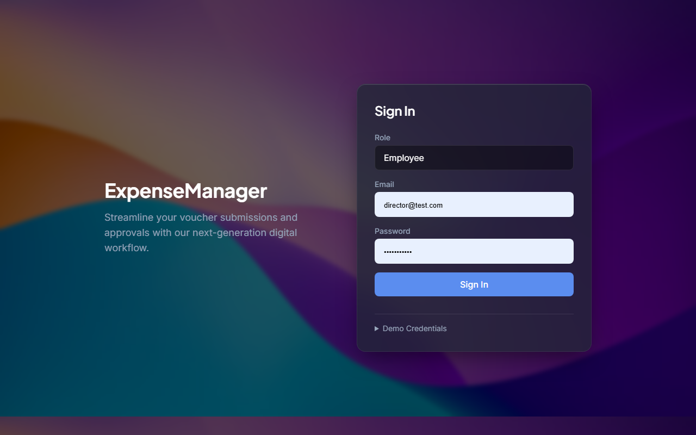
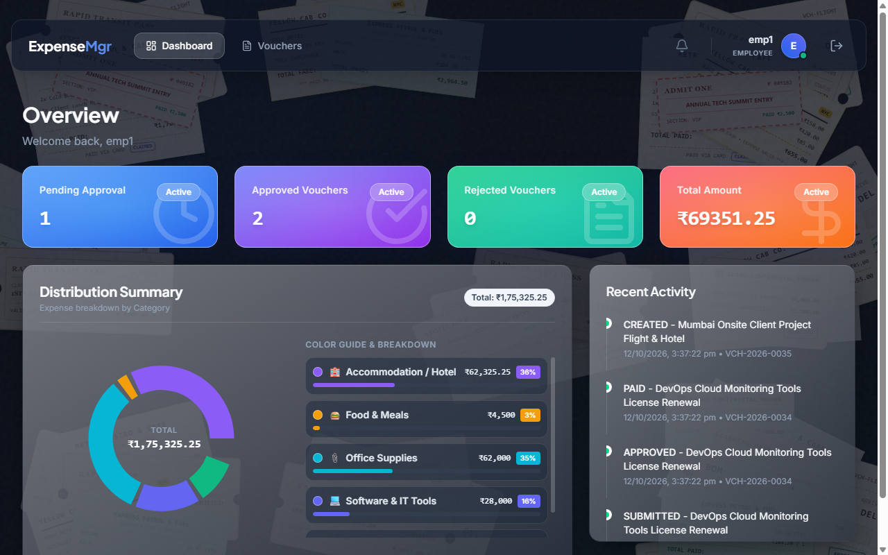
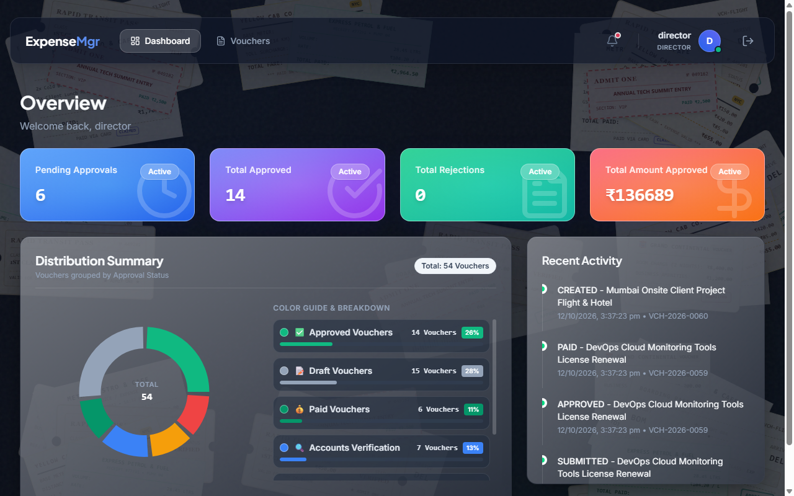
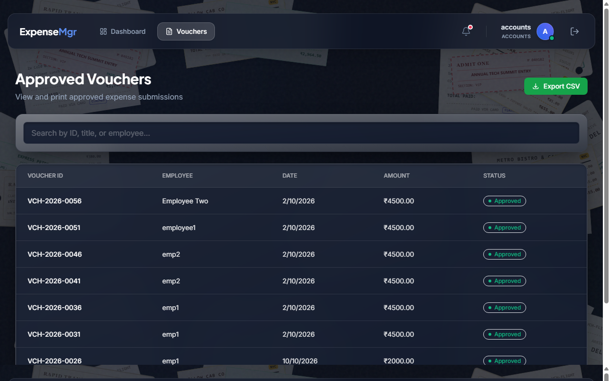

# Expense Voucher Management System
> Full Stack Developer Internship Assignment — Prachay Securities Private Limited

A comprehensive, production-quality, and secure web application that digitizes the employee expense reimbursement lifecycle from draft creation to multi-role approvals and accounts disbursement.

---

## 📌 GitHub Repository & Demo Video
* **Repository Link**: [https://github.com/Yash-Ranpariya/voucher-create](https://github.com/Yash-Ranpariya/voucher-create)
* **Demo Video Walkthrough**: [Watch Interactive Demo Walkthrough & Video](https://github.com/Yash-Ranpariya/voucher-create#demo-video-walkthrough)
* **Submission Presentation PDF**: [`Project_Presentation_and_Submission.pdf`](./Project_Presentation_and_Submission.pdf)

---

## 📸 Application Screenshots

| Role-Based Sign In | Employee Dashboard |
|:---:|:---:|
|  |  |

| Director Approval Center | Accounts Monitoring & Reimbursement |
|:---:|:---:|
|  |  |

---

## 🚀 Key Features

* **Role-Based Access Control (RBAC)**:
  * **Employee**: Create, edit, and delete draft vouchers, upload signature images, submit vouchers for approval, and track real-time status.
  * **Director**: Review submitted vouchers across the organization, search/filter/sort, approve vouchers with digital signature upload, or reject vouchers with mandatory remarks.
  * **Accounts Team**: View and monitor all organization vouchers, search/filter/sort (bonus feature), verify budgets for high-value claims, and process reimbursements (Razorpay integration).
* **Voucher Approval Workflow**:
  * `DRAFT` ➔ `SUBMITTED` (`PENDING_APPROVAL` or `PENDING_ACCOUNTS_VERIFICATION` for amounts ≥ ₹50,000) ➔ `APPROVED` (with Director signature) or `REJECTED` (with reason) ➔ `PAID` (Accounts clearance).
* **Digital Signatures**:
  * Direct canvas draw or image upload for Employee submission and Director approval.
* **Modern Premium UI / UX**:
  * Glassmorphism interface, custom dark aesthetic, responsive layout, animated interactive charts (Recharts), and smooth Framer Motion transitions.
* **Automated Audit Trail**:
  * Every voucher change is recorded chronologically with actor ID, action type, timestamps, and notes.

---

## 🛠️ Technology Stack

| Layer | Technology | Purpose |
|---|---|---|
| **Frontend** | React 18, Vite, TypeScript | Modern, high-performance client SPA |
| **Styling** | Tailwind CSS + Custom Glassmorphism | Dark theme, responsive cards, micro-animations |
| **State & Networking** | TanStack React Query, Axios, React Hook Form, Zod | Type-safe form validation & server-state cache |
| **Backend** | Node.js, Express.js, TypeScript | RESTful API architecture |
| **Database & ORM** | SQLite (`server/prisma/dev.db`), Prisma ORM | Zero-setup, portable, ACID-compliant database |
| **Authentication** | JWT (JSON Web Tokens), Bcrypt | Stateless authentication with role verification |
| **File Uploads** | Multer | Secure signature and receipt uploads |

---

## ⚙️ Project Setup Instructions

### Prerequisites
* **Node.js** (v18.x or later)
* **npm** (v9.x or later)

### 1. Clone Repository
```bash
git clone https://github.com/Yash-Ranpariya/voucher-create.git
cd voucher-create
```

### 2. Backend Setup
```bash
cd server
npm install
```

Configure environment file:
* Copy `.env.example` to `.env`:
```bash
cp .env.example .env
```
*(The default SQLite database is pre-configured and located at `server/prisma/dev.db`)*

Generate Prisma client & run database seed:
```bash
npx prisma generate
npx prisma db push
npm run dev
```
The backend API server will run at: **`http://localhost:5000`**

### 3. Frontend Setup
In a new terminal window:
```bash
cd client
npm install
npm run dev
```
The frontend application will be live at: **`http://localhost:5173`**

---

## 🔑 Demo Login Accounts

| Role | Email | Password | Access / Scope |
|---|---|---|---|
| **Employee (1)** | `emp1@abc.com` / `employee1@abc.com` | `Password@123` | Create vouchers, view personal submissions |
| **Employee (2)** | `emp2@abc.com` / `employee2@abc.com` | `Password@123` | Create vouchers, view personal submissions |
| **Director** | `director@abc.com` | `Password@123` | Organization-wide approvals & rejections |
| **Accounts** | `accounts@abc.com` | `Password@123` | Organization-wide voucher monitoring & payment |

---

## 🗄️ Database Schema Explanation

The schema is built using Prisma ORM (`server/prisma/schema.prisma`):

1. **`User`**:
   * Attributes: `id` (UUID), `name`, `email` (unique), `password_hash`, `role` (`EMPLOYEE` | `DIRECTOR` | `ACCOUNTS`), `employee_code`, `department`, `signature_url`, `created_at`, `updated_at`.
   * Establishes relationships with vouchers (`employeeVouchers`, `directorVouchers`) and notifications.
2. **`Voucher`**:
   * Attributes: `id` (UUID), `voucher_number` (unique, generated via counter `VCH-YYYY-NNNN`), `voucher_date`, `expense_date`, `department`, `title`, `category`, `description`, `amount`, `status`, `receipt_url`, `employee_signature_url`, `director_signature_url`, `rejection_reason`, `transaction_id`, `submitted_at`, `approved_at`, `rejected_at`, `paid_at`.
   * Indexed by `employee_id`, `status`, `expense_date`, and `voucher_number` for fast querying.
3. **`VoucherActivity`**:
   * Complete audit trail recording all transitions: `id`, `voucher_id`, `actor_id`, `action` (`CREATED`, `UPDATED`, `SUBMITTED`, `APPROVED`, `REJECTED`, `PAID`), `note`, `created_at`.
4. **`VoucherCounter`**:
   * Singleton table for atomic, transaction-safe voucher numbering per calendar year.
5. **`Notification`**:
   * In-app notifications alerting users about status updates and review requests.

---

## 📡 API Documentation

Base URL: `http://localhost:5000/api`

| Method | Endpoint | Allowed Role | Purpose |
|---|---|---|---|
| `POST` | `/auth/login` | Public | Authenticate user and issue JWT |
| `GET` | `/auth/me` | Authenticated | Retrieve current session user profile |
| `POST` | `/auth/logout` | Authenticated | Logout user session |
| `GET` | `/vouchers` | All (Role-scoped) | List vouchers with search, filtering, pagination, and sorting |
| `GET` | `/vouchers/:id` | All (Role-scoped) | Retrieve voucher details and audit activity history |
| `POST` | `/vouchers` | `EMPLOYEE` | Create a new voucher draft |
| `PUT` | `/vouchers/:id` | `EMPLOYEE` (Owner) | Edit an existing draft voucher |
| `DELETE`| `/vouchers/:id` | `EMPLOYEE` (Owner) | Delete an existing draft voucher |
| `POST` | `/vouchers/:id/submit` | `EMPLOYEE` (Owner) | Submit draft with employee signature |
| `POST` | `/vouchers/:id/approve` | `DIRECTOR` | Approve voucher with director signature |
| `POST` | `/vouchers/:id/reject` | `DIRECTOR` | Reject voucher with mandatory reason |
| `POST` | `/vouchers/:id/verify` | `ACCOUNTS` | Verify high-value voucher budget (≥ ₹50,000) |
| `POST` | `/vouchers/:id/pay` | `ACCOUNTS` | Initiate Razorpay payment for approved voucher |
| `GET` | `/dashboard/summary` | All (Role-scoped) | Get dashboard statistics, metrics, and chart data |
| `POST` | `/upload/receipt` | Authenticated | Upload expense receipt image or document |

*For complete API schemas and query parameter definitions, check [`openapi.yaml`](./openapi.yaml).*

---

## 💡 Assumptions & Design Decisions

1. **Status Lifecycle**:
   * "Submitted" is represented by `PENDING_APPROVAL` (or `PENDING_ACCOUNTS_VERIFICATION` when amount is ₹50,000+). `submitted_at` stores the exact submission timestamp.
2. **Signatures**:
   * Employees attach their digital signature during submission. Directors upload or draw their signature upon approving. Once approved, vouchers become strictly immutable.
3. **Data Scope / Isolation**:
   * Employees can strictly view and edit only their own drafts and submitted vouchers.
   * Directors and Accounts can view all vouchers across the company.
4. **Receipt Optical Character Recognition (OCR)**:
   * Built-in receipt scanning (`tesseract.js`) automatically pre-fills amounts, dates, and titles when receipts are uploaded.
5. **Database Choice**:
   * SQLite was configured via Prisma for frictionless evaluation and portability out-of-the-box without requiring an external database server, while maintaining full compatibility with PostgreSQL/MySQL.

---

## 📄 License & Confidentiality
This project is developed for the Full Stack Developer Internship Assignment at **Prachay Securities Private Limited**.
